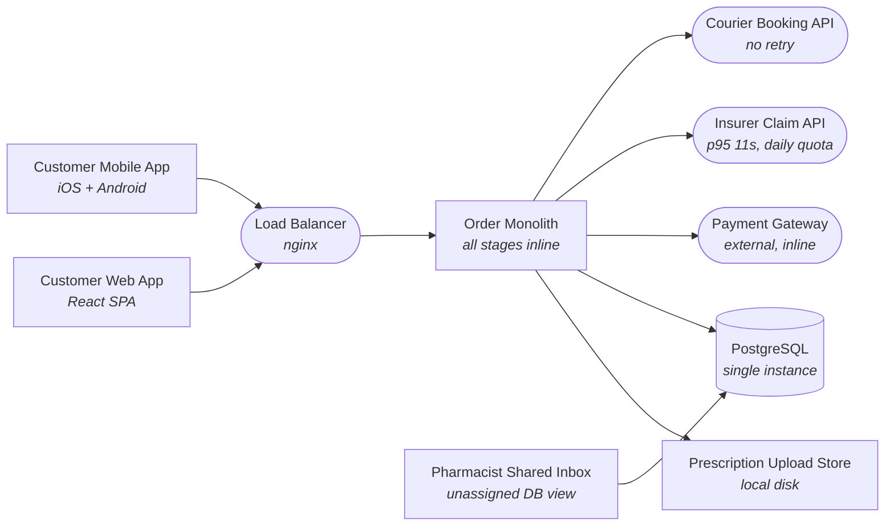

# Mediq Order Fulfilment Async Redesign Design — Software Design Document

| | |
|---|---|
| **Status** | Documents the current system |
| **Last updated** | 2026-08-16 |

## 1. Introduction & Overview

MediQ is a licensed online pharmacy operating in four countries, filling roughly 40,000 orders per day at peak. Unlike a general retailer, MediQ cannot ship an order until a qualified pharmacist has reviewed the customer's uploaded prescription, and in most cases an insurance claim must be filed with a national insurer before the order is considered financially complete. The business lives and dies on two numbers: how many customers actually finish checkout, and how few orders get lost or stuck once money has changed hands. Regulators additionally require a complete, tamper-evident history of every state an order passed through. The current system was built as a single Spring Boot monolith when MediQ served one country, and it has not kept up with either the volume or the regulatory surface.

**Objective of this document:** describe the system as it runs today — its architecture, data, interfaces and components. The design goal: Redesign a blocking, inline pharmacy checkout into a reliable staged async pipeline. Isolate a slow/quota-limited insurer and a flaky courier so no paid order is ever lost.

## 2. System Architecture

Web and mobile clients hit an nginx load balancer that forwards to one Order Monolith, which performs the entire fulfilment sequence inline within the checkout HTTP request: it stores the prescription image to local disk, writes the order to a single PostgreSQL instance, calls the external Payment Gateway to capture payment, then calls the external Insurer Claim API, and finally calls the Courier Booking API — all before returning a response. Prescription review is the one step that is not inline: pharmacists open a shared, unassigned PostgreSQL view of 'pending' prescriptions sorted by upload time, pick whatever they want, and after approving, a staff member manually re-enters the approved order back into the order flow. There is no queue, no per-stage retry, and no idempotency: each checkout is one long synchronous transaction against the monolith and the database, with the insurer call sitting in the critical path.

> The architecture diagram below is the same system that is pre-drawn (locked) on the whiteboard for this task; this repository contains its implementation.

### 2.1 Architecture Diagram (current system)

| Component | Role |
|---|---|
| Customer Web App | React SPA |
| Customer Mobile App | iOS + Android |
| Load Balancer | nginx |
| Order Monolith | all stages inline |
| Prescription Upload Store | local disk |
| PostgreSQL | single instance |
| Pharmacist Shared Inbox | unassigned DB view |
| Payment Gateway | external, inline |
| Insurer Claim API | p95 11s, daily quota |
| Courier Booking API | no retry |

### 2.2 Known Limitations (observed in production)

Because the insurer API's p95 is 11.3s and it runs inside checkout, checkout p95 is 14.2s and roughly 78% of that time is the insurer call; at peak the 400-thread pool is nearly exhausted (380 concurrent) between 6 and 8pm and checkout abandonment sits at 31%. When Germany's insurer quota is hit at 6pm the API returns HTTP 429 in bulk (1,204 in one minute) and the whole checkout fails and rolls back even though payment had already been captured — so claims that could legally be filed hours later instead sink the entire order. A courier outage on March 14 timed out 1,900 checkouts after payment; because there is no retry and no persisted stage state, those 1,900 orders were left PAID with no courier booked and no visibility to anyone. Meanwhile the unassigned shared inbox causes two pharmacists to review the same prescription (e.g. Rx 8871 approved by two people) while the oldest pending prescription waits over four hours against a 30-minute target.

## 3. Data Design

| Store | Kind | Details |
|---|---|---|
| Prescription Upload Store | storage | local disk |
| PostgreSQL | database | single instance — tables: `orders`, `prescriptions`, `payments`, `claims` |

Data-layer implementation: `src/main/java/com/medix/orders/domain/Order.java`, `src/main/java/com/medix/orders/domain/OrderStatus.java`, `src/main/java/com/medix/orders/domain/Prescription.java`, `src/main/java/com/medix/orders/repo/OrderRepository.java`, `src/main/java/com/medix/orders/repo/PrescriptionRepository.java`

## 4. Interface Design

External integration points of the current system:

- **Clients** — Customer Web App, Customer Mobile App.
- **Load Balancer** — nginx.
- **Payment Gateway** — external, inline.
- **Insurer Claim API** — p95 11s, daily quota.
- **Courier Booking API** — no retry.

## 5. Component Design

| Component | Implementation |
|---|---|
| Order Monolith | `src/main/java/com/medix/orders/OrderMonolithApplication.java`, `src/main/java/com/medix/orders/service/CheckoutService.java`, `src/main/java/com/medix/orders/web/ApiExceptionHandler.java`, `src/main/java/com/medix/orders/web/CheckoutController.java`, `src/main/java/com/medix/orders/web/dto/CheckoutRequest.java` |
| PostgreSQL | `src/main/java/com/medix/orders/domain/Order.java`, `src/main/java/com/medix/orders/domain/OrderStatus.java`, `src/main/java/com/medix/orders/domain/Prescription.java`, `src/main/java/com/medix/orders/repo/OrderRepository.java`, `src/main/java/com/medix/orders/repo/PrescriptionRepository.java` |
| Payment Gateway | `src/main/java/com/medix/orders/external/ExternalClients.java` |
| Pharmacist Shared Inbox | `src/main/java/com/medix/orders/service/PharmacistInboxService.java`, `src/main/java/com/medix/orders/web/PharmacistController.java` |

## 6. Assumptions, Constraints & Scale

You must support 40,000 orders/day at peak spread across four countries, with checkout — defined as order accepted and payment authorized — responding at p95 under 2 seconds. Prescription review must meet a 30-minute SLA and must assign each prescription to exactly one pharmacist so no prescription is reviewed twice. No order may be lost through any third-party outage: every stage transition must survive process crashes and be safely retryable. Insurer calls must respect a hard per-country daily quota and may be deferred by up to 6 hours, so filing a claim later is acceptable but dropping it is not. A full, ordered audit trail of every order-state transition is required for regulators. The available infrastructure is exactly one message broker, one Redis, and one managed PostgreSQL — you should not assume any other managed service exists.

## 7. Glossary

- **Idempotency** — Designing an operation so that receiving/processing it more than once has the same effect as processing it exactly once — essential under at-least-once delivery and retries.
- **Circuit breaker** — A resilience pattern that stops calling a failing dependency after an error threshold, fails fast for a cooldown, then probes for recovery — protecting caller threads from a slow third party.
- **Saga / compensation** — A long-running workflow made of local steps where, if a later step fails, earlier committed steps are undone by explicit compensating actions (e.g. refund, release stock) instead of a single distributed rollback.
- **Transactional outbox** — Writing a domain state change and its outgoing message into the same database transaction, then relaying that message to the broker, so a state change and its event can never diverge on a crash.
- **Backpressure / deferral** — Slowing, buffering, or postponing work when a downstream (like a quota-limited insurer) cannot accept it now, so requests are delayed and retried within an allowed window rather than dropped.
